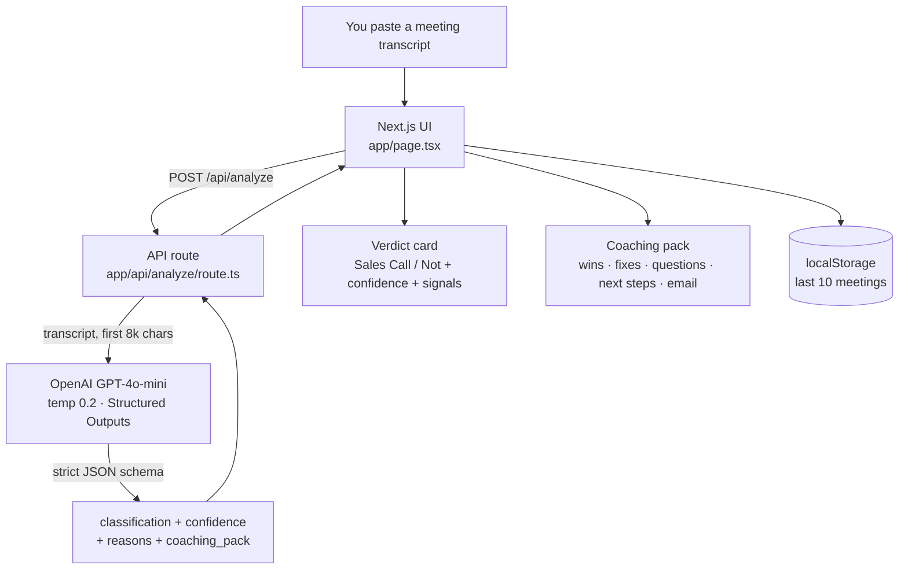
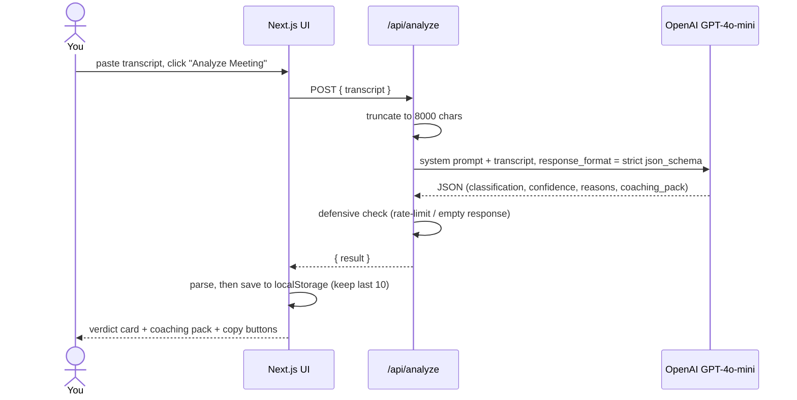
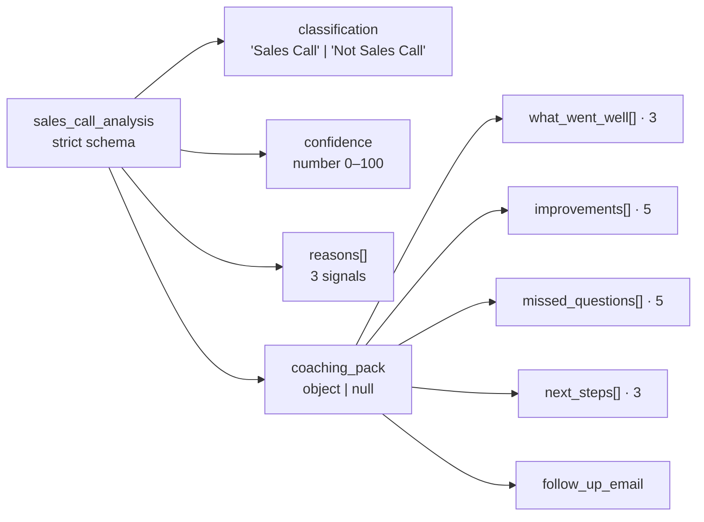
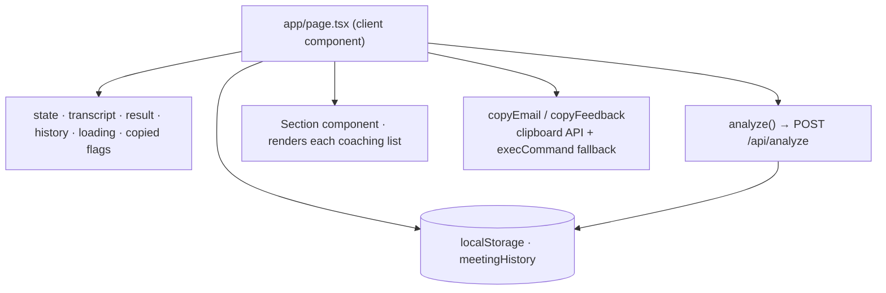

<p align="center">
  
</p>

<p align="center">
  <a href="https://granola-sales-coach.vercel.app/"></a>
  
  
  
  
  
</p>

<p align="center">
  <b>Paste a meeting transcript. Get told whether it was a sales call — and exactly how to run the next one better.</b><br>
  Granola Sales Coach reads a transcript, decides if it's a sales call, and writes you a coaching pack plus a ready-to-send follow-up email.
</p>

<p align="center">
  <a href="https://granola-sales-coach.vercel.app/"><b>► Try the live app</b></a>
</p>

---

## Contents

- [What it does](#what-it-does)
- [Why I built it](#why-i-built-it)
- [What you get back](#what-you-get-back)
- [How it works](#how-it-works)
- [The analysis pipeline](#the-analysis-pipeline)
- [The output contract](#the-output-contract)
- [How the frontend is wired](#how-the-frontend-is-wired)
- [Engineering decisions worth calling out](#engineering-decisions-worth-calling-out)
- [Tech stack](#tech-stack)
- [Project structure](#project-structure)
- [Run it locally](#run-it-locally)
- [Privacy](#privacy)
- [What I'd build next](#what-id-build-next)
- [License](#license)
- [Contact](#contact)

---

## What it does

[Granola](https://www.granola.ai/) takes great notes during your meetings — but it won't tell you whether your sales call actually went well. This fills that gap.

Paste a transcript (from Granola, or any meeting tool) and **Granola Sales Coach** does two things:

1. **Classifies** the meeting as a *Sales Call* or *Not a Sales Call*, with a confidence score and the three signals it keyed off of.
2. If it *is* a sales call, it writes a **coaching pack** — what went well, what to improve, the questions you should have asked, concrete next steps, and a follow-up email you can copy and send.

If it isn't a sales call, it says so and stops — no fake coaching on your standup.

---

## Why I built it

Sales reps replay calls in their head for hours and still miss the obvious stuff: the budget question they never asked, the vague next step, the follow-up email that never went out. Meanwhile the full transcript is just sitting there.

I wanted the shortest possible loop between *"here's what was said"* and *"here's how to do better next time."* Paste, wait a few seconds, get specific feedback and a draft email. No dashboard, no setup, no integration to configure.

The interesting engineering question underneath it: **how do you make a language model return something a UI can trust every single time?** A coaching tool is useless if the response is sometimes prose, sometimes JSON, sometimes missing the email. Solving that — forcing a guaranteed shape — is what most of the backend is about.

---

## What you get back

For a sales call, the coaching pack is deliberately fixed-size so the UI is predictable:

- **What went well** — 3 things you did right
- **Improvements** — 5 actionable fixes
- **Missed questions** — 5 questions you should have asked
- **Next steps** — 3 concrete follow-ups
- **Follow-up email** — a 5–8 line draft, ready to copy

Plus the verdict up top: *Sales Call / Not Sales Call*, a 0–100 confidence score, and the three signals behind the call.

---

## How it works

One transcript, one API route, one model call with a guaranteed response shape.



---

## The analysis pipeline



---

## The output contract

This is the heart of the project. The model isn't asked to "please return JSON" — it's pinned to a **strict JSON schema** via OpenAI's Structured Outputs, so the response is guaranteed to match this shape or the call fails. The UI never has to defend against a stray sentence or a missing field.



`coaching_pack` is nullable on purpose — when the meeting isn't a sales call, the model returns `null` for it and the UI simply shows the verdict.

---

## How the frontend is wired

It's a single client page. State lives in React; history lives in the browser.



The **Recent Meetings** list is read from `localStorage` on load and capped at the last 10. Click any past meeting to reload its full result instantly — no second API call.

---

## Engineering decisions worth calling out

| Decision | Why |
|---|---|
| **Structured Outputs with a `strict` JSON schema** | The model is forced to return exactly `{ classification, confidence, reasons, coaching_pack }` — fixed-length arrays and all. No regex, no "did it return JSON this time" branching. The contract is the schema. |
| **Classify first, coach second** | The model decides *Sales Call / Not* before anything else, and returns `null` coaching for non-sales meetings — so the tool doesn't hallucinate sales advice on an engineering standup. |
| **`temperature: 0.2`** | Low enough that the same transcript gives a stable verdict, with just enough room for the email to read naturally. |
| **Transcript capped at 8,000 chars** | Keeps latency and token cost predictable; the UI warns you when it's analyzing a partial transcript. |
| **History in `localStorage`, not a database** | The last 10 meetings stay on your machine. No accounts, no server-side storage of what was said in your calls. |
| **Clipboard with a fallback** | Copy buttons use the async Clipboard API and fall back to a hidden-textarea `execCommand` copy for browsers/contexts that block it. |
| **Defensive check on the AI response** | If OpenAI returns no choices (rate limit, bad key), the route throws a clean error instead of crashing on `undefined`. |

---

## Tech stack

| Layer | Choice |
|---|---|
| Framework | Next.js 16 (App Router) + React 19 |
| Language | TypeScript |
| Styling | Tailwind CSS v4 |
| AI | OpenAI GPT-4o-mini (Structured Outputs) |
| State / history | React state + browser `localStorage` |
| Hosting | Vercel |

No client SDKs and no database — the backend is a single `fetch` to OpenAI, which keeps the dependency list tiny.

---

## Project structure

```text
granola-sales-coach/
├── app/
│   ├── api/analyze/route.ts   # the one endpoint: transcript -> GPT-4o-mini -> strict JSON
│   ├── layout.tsx             # fonts + metadata
│   ├── page.tsx               # the whole UI: input, verdict, coaching pack, history
│   └── globals.css            # Tailwind + theme tokens
├── public/                    # icons
├── banner.svg                 # README art
└── package.json
```

---

## Run it locally

You'll need an OpenAI API key.

```bash
git clone https://github.com/ShahZainSahir/granola-sales-coach.git
cd granola-sales-coach
npm install
```

Create a `.env.local` in the project root:

```bash
OPENAI_API_KEY=sk-...
```

Then:

```bash
npm run dev
```

Open [http://localhost:3000](http://localhost:3000), paste a transcript, and hit **Analyze Meeting**. The `.env.local` is git-ignored — your key never leaves your machine.

---

## Privacy

- **Transcripts aren't stored server-side.** They're sent to OpenAI for the single analysis call and not persisted by this app.
- **History is local only.** Your last 10 meetings live in your browser's `localStorage`, and the **Delete history** button clears them.

---

## What I'd build next

- **Direct Granola import** so you don't have to copy-paste the transcript.
- **Streaming results** — show the verdict the instant it's ready, then stream the coaching pack in.
- **Trend tracking** — chart your improvement areas across calls over time.
- **Tone/CRM-aware email drafts** that pull in the prospect's name and the actual next step.
- **An evals set** — labelled transcripts with expected verdicts, run on every deploy so prompt changes can't quietly regress the classifier.

---

## License

Released under the [MIT License](LICENSE).

---

## Contact

**Zain Sahir Shah**

[](https://linkedin.com/in/zain-sahir-s-4b1a9a227)
[](https://github.com/ShahZainSahir)
[](mailto:shahzain.zeza@gmail.com)

Questions or ideas? Open an issue or reach out — always happy to talk through it.
