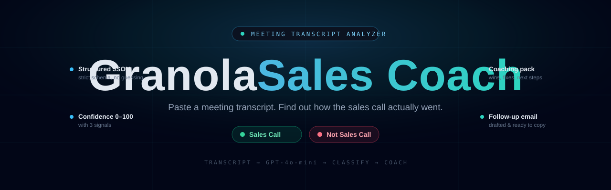
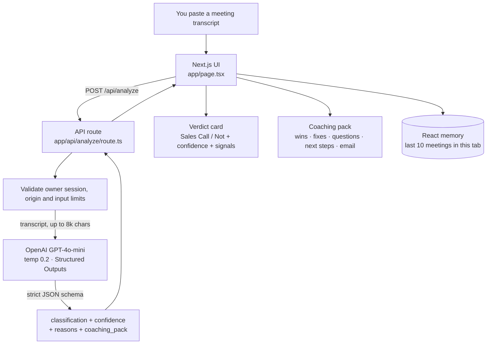
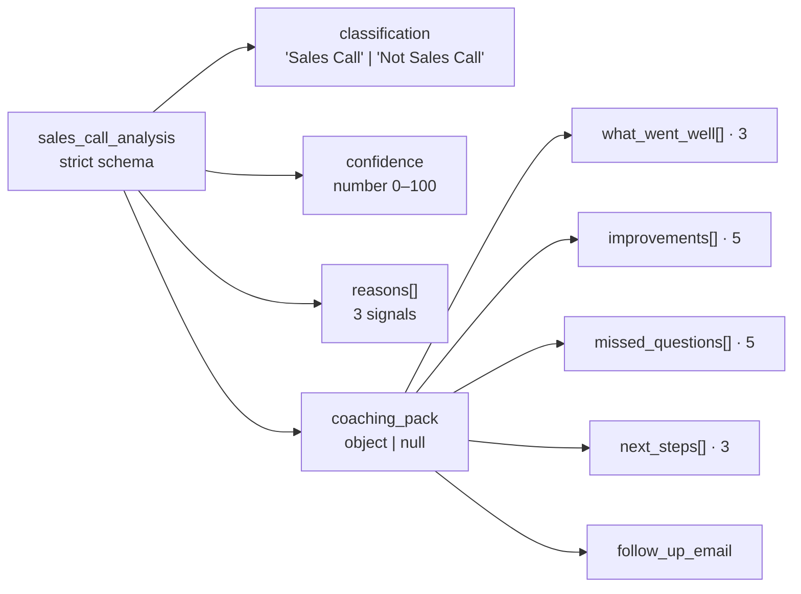
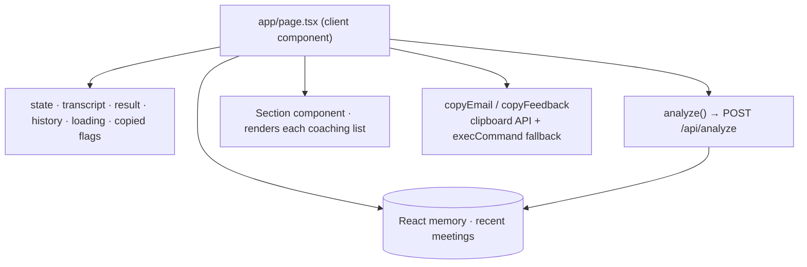

<p align="center">
  
</p>

<p align="center">
  <a href="https://granola-sales-coach.vercel.app/"></a>
  
  
  
  
  
</p>

<p align="center">
  <b>Paste a meeting transcript. Get told whether it was a sales call — and exactly how to run the next one better.</b><br>
  Granola Sales Coach reads a transcript, decides if it's a sales call, and writes you a coaching pack plus a follow-up email draft to review.
</p>

<p align="center">
  <a href="https://granola-sales-coach.vercel.app/"><b>► View the app</b></a>
</p>

---

## Contents

- [What it does](#what-it-does)
- [Why I built it](#why-i-built-it)
- [What you get back](#what-you-get-back)
- [How it works](#how-it-works)
- [The analysis pipeline](#the-analysis-pipeline)
- [The output contract](#the-output-contract)
- [How the frontend is wired](#how-the-frontend-is-wired)
- [Engineering decisions worth calling out](#engineering-decisions-worth-calling-out)
- [Tech stack](#tech-stack)
- [Project structure](#project-structure)
- [Run it locally](#run-it-locally)
- [Privacy](#privacy)
- [What I'd build next](#what-id-build-next)
- [License](#license)
- [Contact](#contact)

---

## What it does

[Granola](https://www.granola.ai/) takes great notes during your meetings — but it won't tell you whether your sales call actually went well. This fills that gap.

Paste a transcript (from Granola, or any meeting tool) and **Granola Sales Coach** does two things:

1. **Classifies** the meeting as a *Sales Call* or *Not a Sales Call*, with a confidence score and the three signals it keyed off of.
2. If it *is* a sales call, it writes a **coaching pack** — what went well, what to improve, the questions you should have asked, concrete next steps, and a follow-up email you can copy and send.

If it isn't a sales call, it says so and stops — no fake coaching on your standup.

The interface is public. Paid analysis requires the owner's private access code, which creates a signed one-hour browser session.

---

## Why I built it

Sales reps replay calls in their head for hours and still miss the obvious stuff: the budget question they never asked, the vague next step, the follow-up email that never went out. Meanwhile the full transcript is just sitting there.

I wanted the shortest possible loop between *"here's what was said"* and *"here's how to do better next time."* Paste, wait a few seconds, get specific feedback and a draft email. No dashboard, no setup, no integration to configure.

The interesting engineering question underneath it: **how do you make a language model return something the UI can use reliably?** A coaching tool is useless if the response is sometimes prose, sometimes JSON, sometimes missing the email. Structured Outputs plus server-side validation make that contract explicit.

---

## What you get back

For a sales call, the coaching pack is deliberately fixed-size so the UI is predictable:

- **What went well** — 3 things you did right
- **Improvements** — 5 actionable fixes
- **Missed questions** — 5 questions you should have asked
- **Next steps** — 3 concrete follow-ups
- **Follow-up email** — a 5–8 line draft, ready to copy

Plus the verdict up top: *Sales Call / Not Sales Call*, a 0–100 confidence score, and the three signals behind the call.

---

## How it works

One transcript, one protected analysis route, one model call with a validated response shape.



---

## The analysis pipeline

```mermaid
sequenceDiagram
    actor You
    participant UI as Next.js UI
    participant API as /api/analyze
    participant AI as OpenAI GPT-4o-mini

    You->>UI: paste transcript, click "Analyze Meeting"
    UI->>API: POST { transcript }
    API->>API: verify owner session and same origin; reject invalid or oversized input
    API->>AI: system prompt + transcript, response_format = strict json_schema
    AI-->>API: JSON (classification, confidence, reasons, coaching_pack)
    API->>API: bound response size, validate fields, counts and text lengths
    API-->>UI: { result }
    UI->>UI: validate, then keep last 10 results in tab memory
    UI-->>You: verdict card + coaching pack + copy buttons
```

---

## The output contract

The model is given a **strict JSON schema** through OpenAI's Structured Outputs. The server also checks the classification, confidence range, exact list counts and text lengths. Refusals, truncated outputs and malformed responses return a safe error instead of reaching the result cards.



`coaching_pack` is nullable on purpose — when the meeting isn't a sales call, the model returns `null` for it and the UI simply shows the verdict.

---

## How the frontend is wired

It's a single client page. Inputs, results and recent meetings live in React memory for the current tab.



The **Recent Meetings** list contains up to 10 results from the current tab. Click one to reopen it without another model call. Reloading or signing out clears this memory. Saved history from the previous version is not loaded or modified automatically; an explicit delete control removes it from this browser.

---

## Engineering decisions worth calling out

| Decision | Why |
|---|---|
| **Structured Outputs plus server validation** | The model receives a strict object schema; the server checks exact list counts, confidence and text bounds before displaying a result. |
| **Classify first, coach second** | The model decides *Sales Call / Not* before anything else, and returns `null` coaching for non-sales meetings — so the tool doesn't hallucinate sales advice on an engineering standup. |
| **`temperature: 0.2`** | Low enough that the same transcript gives a stable verdict, with just enough room for the email to read naturally. |
| **Transcript capped at 8,000 chars** | Oversized transcripts are rejected before model use. Request streams are bounded to 64 KiB with a five-second read deadline. |
| **Owner-only analysis** | The server validates a signed, expiring HttpOnly session before reading transcripts or contacting the provider. Missing or weak access-code configuration disables analysis. |
| **History in tab memory** | New results are not written to localStorage or a database. An explicit control can delete history stored by the older version. |
| **Clipboard with a fallback** | Copy buttons use the async Clipboard API and fall back to a hidden-textarea `execCommand` copy for browsers/contexts that block it. |
| **Bounded provider work** | A 25-second timeout, 2,000-token output cap, 64 KiB response limit and server validation constrain each owner request. Provider errors are sanitized; transcript-derived content is not logged by the app. |

---

## Tech stack

| Layer | Choice |
|---|---|
| Framework | Next.js 16 (App Router) + React 19 |
| Language | TypeScript |
| Styling | Tailwind CSS v4 |
| AI | OpenAI GPT-4o-mini (Structured Outputs) |
| State / history | React state, current tab only |
| Hosting | Vercel |

No client SDKs and no database — the backend is a single `fetch` to OpenAI, which keeps the dependency list tiny.

---

## Project structure

```text
granola-sales-coach/
├── app/
│   ├── api/analyze/route.ts   # owner-authenticated transcript -> GPT-4o-mini -> validated JSON
│   ├── api/owner-session/    # login, session status and logout
│   ├── lib/                  # server auth, bounded request guards and shared result contract
│   ├── components/           # owner access dialog
│   ├── layout.tsx             # fonts + metadata
│   ├── page.tsx               # the whole UI: input, verdict, coaching pack, history
│   └── globals.css            # Tailwind + theme tokens
├── public/                    # icons
├── banner.svg                 # README art
└── package.json
```

---

## Run it locally

You'll need an OpenAI API key and a private, randomly generated access code of at least 32 characters. Generate the code with a password manager and keep it out of Git and screenshots.

```bash
git clone https://github.com/zshah101/granola-sales-coach.git
cd granola-sales-coach
npm install
```

Create a `.env.local` in the project root:

```bash
OPENAI_API_KEY=sk-...
AI_OWNER_ACCESS_CODE=<your-random-private-code>
```

Then:

```bash
npm run dev
```

Open [http://localhost:3000](http://localhost:3000), select **Owner access** and enter the private code. Then paste a transcript and select **Analyze Meeting**. The `.env.local` file is Git-ignored. The API key stays in server configuration and is sent to OpenAI over HTTPS for authentication; it is never placed in browser code.

For Vercel, configure both variables as server-only environment variables in every environment that should support analysis, then redeploy. Do not prefix them with `NEXT_PUBLIC_`. Without a valid access code, public pages still load and the paid endpoint fails closed. Rotating the access code invalidates existing sessions. Signing out deletes this browser's cookie; a copied session token remains valid until its one-hour expiry or code rotation.

Run `npm run test:security`, `npm run lint` and `npm run build` before deploying. Security tests use synthetic credentials and a mocked provider; they make no paid requests.

---

## Privacy

- **Provider processing:** Authenticated analysis sends the transcript to OpenAI. Its data handling and retention follow the provider's settings and policies. Avoid passwords, API keys and sensitive customer material without appropriate permission.
- **Application storage:** This version does not save transcripts or analysis to a server database or log their contents. New results remain in the current tab's memory, with up to 10 recent results. Signing out, reloading or closing the tab clears them.
- **Older browser history:** Earlier versions wrote results to `localStorage`. This version leaves that data in place until you use **Delete previously saved history**; it does not load it into the UI. The delete control also clears the current input and results.
- **Hosting logs:** The previous version logged generated coaching and emails. Updating the app does not erase previously captured hosting logs or exports; review their retention and access separately. Hosting may retain ordinary request metadata independently of this app.
- **Drafts need review:** The app does not send emails, access a CRM or import from Granola directly. Review generated advice and email drafts before using them.

The owner session prevents anonymous paid use, but it is not a distributed quota or spending cap. Keep the access code private, use a dedicated provider key and review provider usage/limits and hosting account access.

---

## What I'd build next

- **Direct Granola import** so you don't have to copy-paste the transcript.
- **Streaming results** — show the verdict the instant it's ready, then stream the coaching pack in.
- **Trend tracking** — chart your improvement areas across calls over time.
- **Tone/CRM-aware email drafts** that pull in the prospect's name and the actual next step.
- **An evals set** — labelled transcripts with expected verdicts, run on every deploy so prompt changes can't quietly regress the classifier.

---

## License

Released under the [MIT License](LICENSE).

---

## Contact

**Zain Sahir Shah**

[](https://linkedin.com/in/zain-sahir-s-4b1a9a227)
[](https://github.com/ShahZainSahir)
[](mailto:shahzain.zeza@gmail.com)

Questions or ideas? Open an issue or reach out — always happy to talk through it.
